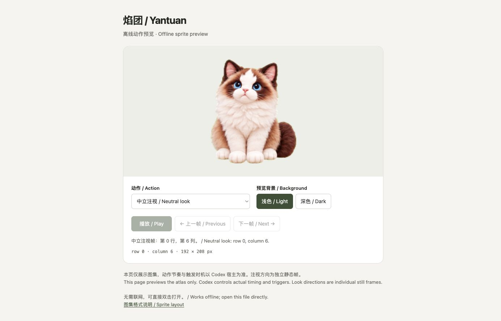

# Yantuan · 焰团

English | [简体中文](README.zh-CN.md)

A blue-eyed Ragdoll cat companion for Codex desktop. Yantuan quietly sways its tail, chases butterflies, waves, and wipes the glass while you work.

This repository shares the **actual installed artwork**, including the September 27, 2026 idle-tail refinement, with an offline preview and small, readable installation tools. Maintained by [LONGEVIS](https://www.longevis.net/).



## Preview

Download or clone the repository, then open **[preview/index.html](preview/index.html)** in your browser. It works offline, with animation selection, frame inspection, and light/dark backgrounds. GitHub's file view shows HTML source; open the downloaded file to run it.

The preview demonstrates the artwork. Actual action triggers, playback speed, desktop movement and pet size are controlled by the host application.

## Install

Requires Python 3.10+ and a Codex desktop build that supports local custom pets through a `pet.json` manifest and sprite version 2. This package does not include the desktop application. The supplied format was used in the maintainer's macOS installation; other versions and platforms may differ.

```sh
git clone https://github.com/lijian19893333-boop/yantuan-codex-pet.git
cd yantuan-codex-pet
python3 scripts/install.py
```

The installer copies only `pet.json` and `spritesheet.webp` to `${CODEX_HOME:-~/.codex}/pets/yantuan-ragdoll`. It does not edit application settings or select a pet. Reopen the app if needed, then choose **焰团** in its pet/avatar picker if available.

An existing installation is preserved by default. To replace it with a backup:

```sh
python3 scripts/install.py --replace
```

For a custom destination or a trial installation:

```sh
python3 scripts/install.py --pets-dir ./pet-install-test
```

Alternatively, copy the complete `pets/yantuan-ragdoll` folder into your app's local pets directory after backing up any existing folder of the same name. To uninstall, select another pet first, then remove the installed `yantuan-ragdoll` folder. Backups are kept separately and are never removed automatically.

## Contents

| Path | Purpose |
|---|---|
| `pets/yantuan-ragdoll/` | Installable manifest and transparent WebP sprite sheet |
| `preview/index.html` | Offline animation and frame viewer |
| `scripts/install.py` | Installer with overwrite protection and backups |
| `scripts/validate.py` | Sprite geometry, manifest and transparency checks |
| `docs/sprite-layout.md` | Rows, frames and directional-look layout |
| `docs/creation-notes.md` | Artwork provenance and practical editing notes |
| `tests/` | Isolated installer regression tests |

The sheet is **1536 × 2288**, with 8 columns and 11 rows of **192 × 208** cells. It contains nine action rows, sixteen directional look frames and one neutral look frame. `jumping` is a host state key; Yantuan's artwork in that row is a glass-wiping gesture.

## Validate and contribute

Installing and previewing need no third-party Python packages. Image validation requires Pillow:

```sh
python3 -m venv .venv
source .venv/bin/activate
python3 -m pip install -r requirements-dev.txt
python3 scripts/validate.py
python3 -m unittest discover -s tests -v
```

On Windows, activate the environment with `.venv\Scripts\activate` and use your Python launcher as appropriate. Cross-platform app integration has not been established by this release.

Contributions are welcome: report your host version and platform, describe a reproducible issue, and check every affected animation in the offline preview. When editing artwork, preserve transparent padding, cell dimensions, row assignments and unused blank cells. See [CONTRIBUTING.md](CONTRIBUTING.md).

## Origin and license

Yantuan was made with AI-assisted image generation and subsequent sprite refinement from a privately supplied cat reference. The private reference photo, generation logs and application code are not distributed. The included tools operate on finished artwork; they do not deterministically recreate the original images.

The repository's contributed code, documentation and supplied Yantuan artwork are offered under the [MIT License](LICENSE), to the extent the contributors can license them. Keep the license notice when redistributing. Codex and OpenAI names identify compatibility only; this is an independent community asset, not an official OpenAI product. See [THIRD_PARTY_NOTICES.md](THIRD_PARTY_NOTICES.md).
