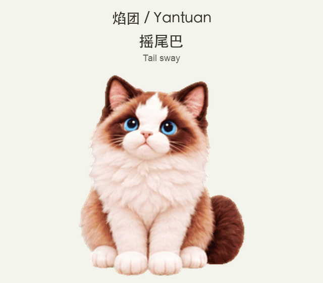

# 焰团 · Yantuan

[English](README.md) | 简体中文

一只陪你工作的蓝眼睛布偶猫。它会安静地微摆尾、追蝴蝶、招手，也会用小爪子擦玻璃。

本仓库分享**实际安装使用的焰团素材**，包含 2026 年 9 月 27 日更新的待机微摆尾，并提供离线预览和可读的安装工具。由 [LONGEVIS 朗静岛](https://www.longevis.net/) 维护。



摇尾巴 → 追蝴蝶 → 擦玻璃。动图使用本包的真实动作帧循环播放；实际节奏与触发时机由宿主应用决定。[查看静态截图](docs/preview.png)。

## 先看看它

下载或克隆仓库后，用浏览器打开 **[preview/index.html](preview/index.html)**。无需联网，可以切换动作、逐帧查看、暂停，以及切换深浅背景。GitHub 文件页只显示 HTML 源码，下载到电脑后打开即可运行。

预览用于查看素材。动作触发、播放速度、桌面移动和显示大小由宿主应用决定。

## 安装

需要 Python 3.10 及以上版本，以及支持通过 `pet.json` 和第 2 版图集加载本地自定义宠物的 Codex 桌面客户端。本仓库不包含客户端。素材格式来自维护者的 macOS 本机安装，其他客户端版本或平台可能存在差异。

```sh
git clone https://github.com/lijian19893333-boop/yantuan-codex-pet.git
cd yantuan-codex-pet
python3 scripts/install.py
```

安装器只复制 `pet.json` 和 `spritesheet.webp` 到 `${CODEX_HOME:-~/.codex}/pets/yantuan-ragdoll`，不会修改应用配置或自动选择宠物。必要时重新打开客户端，再从宠物／头像选择器里选择 **焰团**。

已有同名安装时默认停止；需要更新时使用以下命令，旧目录会先完整备份：

```sh
python3 scripts/install.py --replace
```

也可以指定目录，先做一次试装：

```sh
python3 scripts/install.py --pets-dir ./pet-install-test
```

手动安装时，将整个 `pets/yantuan-ragdoll` 文件夹复制到客户端的本地宠物目录；先备份已有同名目录。卸载时先在客户端切换到其他宠物，再删除安装的 `yantuan-ragdoll` 文件夹。安装器不会自动删除备份。

## 仓库内容

| 路径 | 用途 |
|---|---|
| `pets/yantuan-ragdoll/` | 可安装的配置文件和透明 WebP 动作图集 |
| `preview/index.html` | 离线动作预览和逐帧查看 |
| `scripts/install.py` | 默认拒绝覆盖、支持备份的安装器 |
| `scripts/validate.py` | 配置、尺寸、透明度与有效格位检查 |
| `docs/sprite-layout.md` | 动作行、帧数与注视方向说明 |
| `docs/creation-notes.md` | 素材来源和继续修改的方法 |
| `tests/` | 在临时目录运行的安装回归测试 |

图集为 **1536 × 2288**，共 8 列、11 行，每格 **192 × 208**。包含九行动作、十六个注视方向，以及一格中立注视。`jumping` 是宿主状态名称，焰团这一行的实际画面是擦玻璃。

## 验证与参与

安装和预览无需额外 Python 库；图像校验需要 Pillow：

```sh
python3 -m venv .venv
source .venv/bin/activate
python3 -m pip install -r requirements-dev.txt
python3 scripts/validate.py
python3 -m unittest discover -s tests -v
```

Windows 可用 `.venv\Scripts\activate` 激活环境，并使用本机 Python 启动命令。本次发布尚未建立跨平台客户端集成验证。

欢迎提交动作改进、兼容性反馈和工具修复。反馈时写清客户端版本、操作系统、复现步骤；修改素材后请在预览页检查所有受影响动作，保持透明边距、格位尺寸、行序和空白格。具体见 [CONTRIBUTING.md](CONTRIBUTING.md)。

## 来源与许可

焰团根据私有猫咪参考图，通过 AI 辅助图像生成和后续图集调整制作。仓库不分发原始参考照片、生成任务记录或客户端代码。附带工具处理已完成的画稿，不能从零确定性地重建原始 AI 图像。

本仓库贡献的代码、文档和提供的焰团素材，在贡献者有权授权的范围内使用 [MIT 许可证](LICENSE)。再分发时保留许可声明。Codex 与 OpenAI 名称仅用于说明兼容对象；本项目是独立社区素材，不是 OpenAI 官方产品。另见 [THIRD_PARTY_NOTICES.md](THIRD_PARTY_NOTICES.md)。
